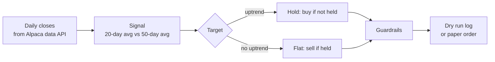

# Paper Trading Bot for Alpaca

[](https://github.com/ketan-pansare/alpaca-paper-trading-bot/actions/workflows/tests.yml)

A small, paper-only trend-following bot built on the [Alpaca Trading API](https://docs.alpaca.markets/) with [`alpaca-py`](https://github.com/alpacahq/alpaca-py).

I built it as a product manager to experience Alpaca's Trading API the way a developer does: getting keys, pulling market data, placing orders, and hitting the edges. It is deliberately simple and heavily guarded, so anyone can read it in ten minutes and run it without risking real money.

> **Not investment advice.** This is a learning project. It only connects to Alpaca **paper** (simulated) accounts and has no live-trading mode.

## Try it in two minutes (no account needed)

```bash
git clone https://github.com/ketan-pansare/alpaca-paper-trading-bot.git
cd alpaca-paper-trading-bot
python -m venv .venv && source .venv/bin/activate   # Windows: .venv\Scripts\activate
pip install -r requirements.txt
python -m bot backtest --sample
```

`--sample` replays the strategy over bundled **synthetic** prices (seeded random walks, not real market data), so it works offline. Example output:

```
Symbol          Days  Trades   Strategy   Buy&Hold   Max DD   In mkt
--------------------------------------------------------------------
SAMPLE_TREND     470       7     44.5%      79.0%    16.2%      75%
SAMPLE_CHOP      470      15    -26.5%     -41.9%    38.5%      37%
SAMPLE_DROP      470      10    -31.0%     -41.7%    32.0%      33%
```

That table already tells the honest story of trend following: it gives up some upside in a strong trend in exchange for smaller losses when prices chop or fall.

## Run it against your paper account

1. Create a free Alpaca account and switch the dashboard to **Paper Trading**.
2. Under **API Keys**, generate a paper key pair.
3. Copy the settings file and add your keys:

   ```bash
   cp .env.example .env
   open -e .env      # macOS: opens in TextEdit. Or use any editor, e.g. nano .env
   ```

   Replace `your_paper_key_id` and `your_paper_secret_key` with your keys (no quotes or spaces), then save.
   In `nano`, save with **Control+O** then Enter, and exit with **Control+X** (Control, not Command).
   Check it worked: `grep -c "your_paper" .env` should print `0`.

4. Backtest on real daily bars (free IEX feed):

   ```bash
   python -m bot backtest
   ```

5. See what the bot would do today. This is a **dry run** and places nothing:

   ```bash
   python -m bot run
   ```

6. When you are happy, let it place **paper** orders (during market hours):

   ```bash
   python -m bot run --place-orders
   ```

Every decision is appended to `journal.csv` with the time, action, quantity and the reason.

## How it decides



The rule: **hold a stock while its 20-day moving average is above its 50-day moving average; otherwise stay out.** Both windows are configurable.

## Guardrails

| Guardrail | What it does |
|---|---|
| Paper only | `TradingClient(paper=True)` is hard-coded, and the bot refuses to start unless `ALPACA_PAPER=true`. |
| Dry run by default | `run` only prints and logs. Orders need `--place-orders`. |
| Position cap | Each position is at most `MAX_POSITION_PCT` of equity (default 10%). |
| Order cap | At most `MAX_ORDERS_PER_RUN` orders per run (default 3); extras are reported, not sent. |
| Market hours | If the market is closed, orders are not sent. |
| Kill switch | Create a file named `STOP` next to the bot and it places nothing. |
| Account check | Stops if Alpaca reports the account as blocked from trading. |

## Project layout

```
paper-trading-bot/
├── bot/
│   ├── __main__.py      # command line: backtest / run
│   ├── config.py        # settings from .env, paper-only enforcement
│   ├── strategy.py      # moving-average signal (pure functions)
│   ├── risk.py          # sizing, order cap, kill switch
│   ├── broker.py        # alpaca-py wrapper pinned to paper
│   ├── backtest.py      # replay + comparison with buy-and-hold
│   └── journal.py       # CSV decision log
├── data/sample_prices.csv   # synthetic prices for offline demo
├── scripts/make_sample_data.py
├── tests/               # 31 tests, no network or account needed
├── .env.example
└── requirements.txt
```

## Tests

```bash
pip install -r requirements-dev.txt
python -m pytest -q
```

The tests run without `alpaca-py` or any network access. The `run` command is exercised end to end against a fake broker.

## Known limitations

- The backtest fills at the daily close with no commissions or slippage.
- Whole shares only; no fractional orders.
- Daily bars only; this is not an intraday strategy.
- One simple rule. It is a teaching example, not a trading system.

## Developer experience notes

**Under 2 minutes from dashboard to a placed paper order.** What I noticed while building on the Trading API, and what I'd ship first as its PM, is in [DEVELOPER_NOTES.md](DEVELOPER_NOTES.md).

## Related

[Self-Serve Connect](https://github.com/ketan-pansare/alpaca-connect-concept): my product concept for Alpaca Connect partner onboarding and OAuth consent.

## License

MIT. Built by Ketan Pansare. Not affiliated with or endorsed by Alpaca.
